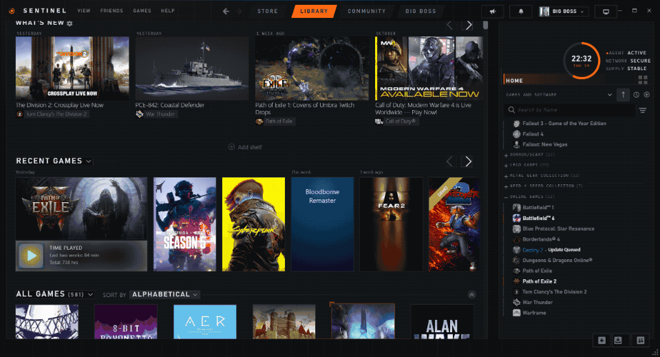

# Sentinel

**A tactical field-agent network.** Charcoal and black, one signal orange, precise minimal type. A Steam client theme for [Beyond Steam](https://github.com/OriginalSwayze/Beyond-Steam) and [Millennium](https://steambrew.app).

- **The inventory on the right:** the game list docks on the right side under an **agent watch** (an orange seconds ring with time, day and status). The page fills the left.
- **Cut navigation tabs** under the title bar, with the active one filled orange.
- **Notched plates:** every panel has a cut corner with an orange tick, and corner brackets lock onto what you hover or select.
- **Inventory rows:** an orange edge marks installed games, and running games pulse **ACTIVE**.
- A tactical grid with a slow scanning line, orange progress bars, an agent-network friends list, network-alert notifications, and an agent-link spinner on boot.

## Install

- **With [Beyond Steam](https://github.com/OriginalSwayze/Beyond-Steam) (easiest):** in Steam press **Ctrl+Shift+B**, open
  **Get more** and install **Sentinel**.
- **By hand:** download **Sentinel.zip** from the [latest release](https://github.com/OriginalSwayze/Sentinel/releases/latest) and unzip
  it into `%APPDATA%\Beyond Steam\themes\Sentinel` (Beyond Steam) or `Steam\millennium\themes\Sentinel` (Millennium).

## Options

In Beyond Steam's **Theme options** tab (or **Millennium → Themes → Sentinel**) you can change:

Signal colour (Signal orange, Amber, Ice blue, Rogue red) · Tactical grid · Inventory side · Density · What's New · Readout · Startup screen · Motion · Privacy · Contrast · Focus rings · Text size

Everything here is original: no other game's names, logos, art or fonts. Fonts are ones that ship with Windows.

## License

MIT, see [LICENSE](LICENSE).
